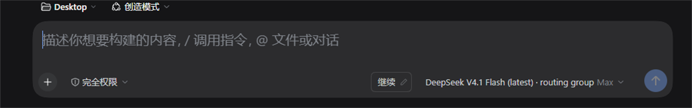
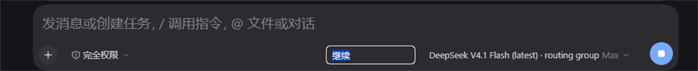
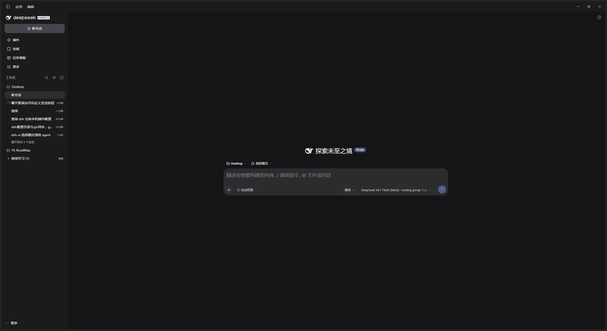

# 发送按钮 · DeepSeek Harness 插件

输入框右边多一个**可改文本**的按钮：点一下，它上面的字就当一条普通提问发出去。默认是「继续」。



省掉「打两个字『继续』→ 回车」这两步；而且这个字你自己定——「继续」「go on」「接着上次的思路」都行。

---

## 怎么用

| 操作 | 结果 |
| --- | --- |
| 左键点按钮 | 按钮上的文本当成一次普通提问发出去 |
| 点按钮右边的铅笔 ✎ | 就地变成输入框，改这段文本 |
| 输入框里回车 / 点到别处 | 保存 |
| 输入框里 Esc | 放弃这次修改 |



- 改完的文本存在浏览器 `localStorage`（键 `dsh-continue-button:text`），刷新、重开都还在。
- 默认值**按界面语言给**：中文界面「继续」，英文界面 `Continue`。改过一次之后不再按语言重置。
- 上限 120 字；它是个按钮，长文本会省略成 `…`，完整内容在 `title` 里。

## 它到底是怎么发出去的

用的**是官方那条发送路**，不是自己调远端：

```
点按钮 → inputActions.setDraft(按钮文本) → inputActions.submit()
```

`inputActions` 是输入框槽位公开给插件的标准 prop，`submit()` 会把当前草稿抄进这次提交再交给提交状态机。
所以行为和按发送键完全一致：

- 代理正在跑的时候点它 → **进队列**，按顺序发；
- 消息**立刻出现在对话里**（本地回显），失败由宿主自己弹错误并恢复草稿；
- 提交用的是按钮文本，所以紧接着**把用户原来的草稿还回输入框**，不吞你正在写的字；
- 发送 / 裁决 / 命令态下按钮是禁用的，不去和状态机抢。

## 装

**从插件市场**：DSH 左侧边栏 → **插件** → **发现** → 找到「发送按钮」→ 安装 → 启用。

**从本地目录**（开发时）：

```powershell
# 让 Agent 装：对当前会话说
# 「用 plugin_manager 的 install_bundle，把 <这个仓库的绝对路径> 装到当前 profile」
```

或者手动：**插件** → **添加插件** → 填这个**目录的绝对路径** → 安装 → 启用。

装完**刷新一次页面**（浏览器半区是纯 JS，没有构建步骤）。换新版本后要重启 DSH，Node 的模块缓存换不掉。

**卸载**：插件页找到这一行 → 先关掉 → 删除。想连文本一起清掉，清掉浏览器里那个 `localStorage` 键。

## 截图

整个窗口的样子（新会话，按钮就在发送键左边）：



## 兼容性

- 声明 `engines.dsh: >=0.2.1-rc.2 <0.3.0`，在 DSH **0.2.1-rc.3** 的桌面版上实测可用。
- 挂在槽位 `conversation.input.right`（官方描述：*Compact controls before the composer submit action*）。
  这是**可增的 list 槽位**（`replaceRisk: none`），只在发送键左边多一格，不覆盖、不替换任何官方控件。
  旧版本没有这个槽位时按钮不出现，也不会报错。
- 只依赖槽位的标准 prop（`t` / `useInput` / `inputActions`），没有 import 任何 Harness 客户端包，
  样式全部用主题 token（`--dsw-alias-*`），跟随浅色/深色。

## 文件一览

| 文件 | 作用 |
| --- | --- |
| `client.js` | 浏览器半区：按钮、编辑框、发送（纯 JS，React 由宿主模块表提供） |
| `index.js` | 宿主半区：空壳，只为了让补丁那行挂得上 |
| `cordis.patch.yml` | 往 profile 插一行 |
| `locale/zh.json`、`locale/en.json` | 插件页里显示的名字和说明 |
| `icon.svg` | 插件图标 |
| `docs/images/` | README 里的截图（真实运行截图） |

## 已知限制

- 按钮文本**按浏览器存**，不是按 profile 存：换浏览器、清站点数据会回到默认值。
- 发出去的就是按钮文本本身，**不带草稿**。想「继续 + 我自己补一句」还是手打。
- 草稿还原是**尽力而为**：极端情况下（提交状态机异步清空草稿的窗口里）可能落到按钮文本上。
- 桌面版会吞掉网页的 `contextmenu`，所以编辑入口只有铅笔这一个，没有右键菜单。

## License

[MIT](LICENSE)

---

[English](README.en.md)
